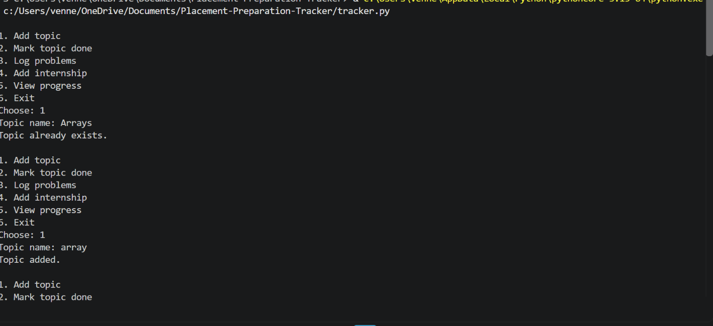

# Placement Preparation Tracker

A Python CLI app to track placement preparation.

## Features

- Add topics and mark them as done
- Log coding problems solved, with date
- Track internship applications
- View overall preparation progress
- JSON-based data storage

## Technologies Used

- Python
- JSON

## How to Run

1. Install Python 3
2. Open the project folder in a terminal
3. Run:

```bash
python tracker.py
```

## Screenshots



## Future Improvements

- Graphical user interface
- Reminders
- Database supportS
